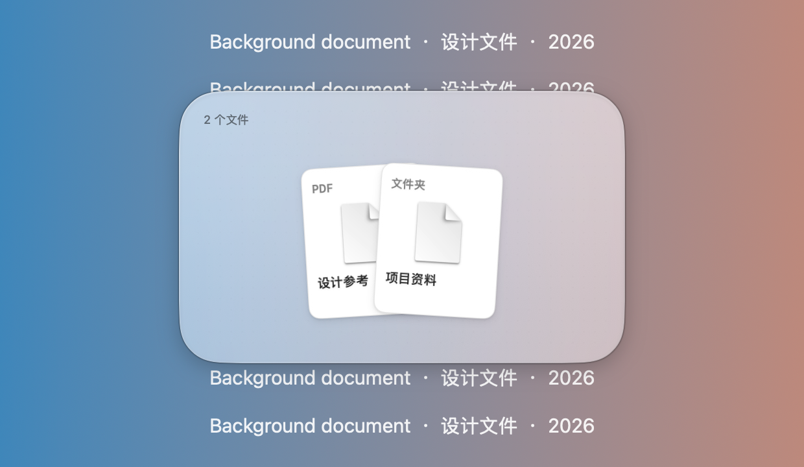

# Tray

一款使用 SwiftUI 与 AppKit 开发的 macOS 菜单栏文件托盘。

[介绍与下载网站](https://tray-by-daniel.shan8888888.chatgpt.site) · [下载 macOS 安装包](https://github.com/Daniel-shan07/Tray/releases/latest)



预览图使用演示文件与测试背景。

拖着文件靠近菜单栏时，Tray 会展开。松手后保存本地副本，之后可从文件卡片拖出到 Finder 或其他支持文件拖放的应用。

## 功能

- 菜单栏常驻，拖着文件接近菜单栏时自动展开
- 文件与文件夹的本地副本保存
- 轻磨砂玻璃、响应式点阵与叠放文件卡片
- 悬停 0.1 秒后，卡片右上角渐显移除按钮
- 双击或选中后按空格，使用 Quick Look 预览
- 拖出、复制、显示副本位置、单项移除与清空确认
- 固定展开、键盘操作、减少动态效果与减少透明度适配

## 构建

运行环境为 macOS 13 或更新版本。当前交付应用为 Apple Silicon 构建。

项目采用 Swift Package，无第三方包依赖。已使用 Xcode 27.2 构建。应用图标采用 `.icon` 格式，打包需要支持此格式的 Xcode 与 `actool`。

在项目目录运行以下命令。

```sh
bash scripts/build-app.sh
open dist/Tray.app
```

也可以使用 Xcode 打开 `Package.swift`，运行 `FileTray` 目标。

构建脚本使用本地临时签名。Developer ID 签名和 Apple 公证由发布者配置。

## 测试

```sh
swift test --disable-sandbox --build-system native
```

测试覆盖文件副本保存与移除、重复文件处理、文件拖拽生命周期、布局与展开动画几何。

## 数据

本地副本和列表保存于 `~/Library/Application Support/FileTray/`。移除操作作用于 Tray 中的副本，副本是加入时的快照。

内部 Swift Package 名称和可执行文件名为 `FileTray`，应用展示名称为 `Tray`。

## 项目结构

- `Sources/FileTray` 包含菜单栏、面板、卡片、拖放与预览界面
- `Sources/TrayCore` 包含存储、拖拽状态、布局与展开动画
- `Tests/TrayCoreTests` 包含核心逻辑测试
- `Assets/AppIcon.icon` 包含应用图标，使用本项目生成的 AI 图像素材
- `scripts/build-app.sh` 生成 `dist/Tray.app`

## 设计来源与许可状态

交互设计参考了 Hoy 的横向圆角托盘与点阵理念。界面代码独立实现，操作图标采用系统 SF Symbols。

本项目采用 [MIT 许可证](LICENSE)。
